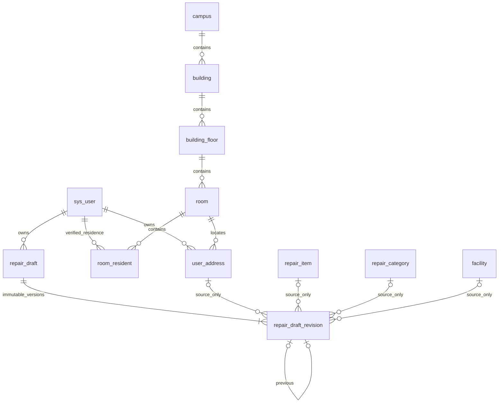

# V2.0-D 实际模型与ER

V7新增4张业务表，public业务表总数23。V8强化修订链，V9验证空用户身份模板，V10按R2允许入住结束时间为空；不修改V1–V6。业务迁移与Flowable引擎结构继续分离，正式工单表族没有新增伪造数据。

|表|字段/约束|
|---|---|
|user_address|id identity、user_id FK、room_id FK、contact_name varchar80、phone varchar30、location_text varchar200、is_default/enabled布尔、version>=0、created_at timestamptz|
|room_resident|id、user_id/room_id/verified_by FK、valid_from/valid_to timestamptz，valid_to可空，非空时from<to、enabled、version>=0、created_at；[from,to)有效|
|repair_draft|id、owner_id FK、current_revision>=0、version>=0、state EDITABLE/ABANDONED、created_at|
|repair_draft_revision|id、draft_id FK、revision_no>0、previous_revision_id、description varchar2000、category_id/item_id/facility_id/source_address_id来源FK、4个jsonb快照、time_mode ANY/WINDOW、window_start/window_end、unattended_willing=false、estimated_minutes1..1440、estimate_source ITEM_DEFAULT/MANUAL、estimate_reason varchar300、complete、created_at|

地址部分唯一索引(user_id) WHERE enabled AND is_default；owner/id索引服务分页。入住user/room/enabled/valid_from/valid_to索引用于EXISTS范围。草稿owner/id索引，修订unique(draft_id,revision_no)。V8用复合外键约束previous在同一草稿，触发器要求初版1、后继+1；current_revision通过延迟外键指向确切修订。更新/删除修订被数据库触发器禁止，应用不提供修改历史接口。

草稿插入可在事务内短暂current_revision=0，提交前必须插入首修订并更新指针；审计失败时聚合及修订一起回滚。地址采用停用保护引用，FK均restrict，不因空间停用删除快照。完整历史数据来自jsonb而不是动态JOIN。

## 事务与锁序

沿用rbac-admin全局guard→认证重校验→业务写入及审计；分类/设施管理也锁同一guard，确保保存时来源一致。默认切换同事务清旧设新，并依赖部分唯一索引最终兜底。草稿锁后校验version，后继修订和当前指针同事务，重复并发修改返回409。

全局写锁适合当前两人课程项目但限制写吞吐，未宣称高并发性能；后续需要分聚合锁时必须保持与RBAC锁序一致。

## 权限迁移

新增4个已实现权限，合计20。非空库使用连接本地c7_confirmed_user_grants(user_id,permission_code)明确逐用户授权，生成独立D7_U_<id>角色；旧共享角色关系不被修改，新增权限不继承到无关共享用户。未知主体/权限、缺映射、失去全权保管人拒绝。受影响用户auth_version/version+1。

空用户库只允许已知种子；V9要求ADMIN覆盖所有20点，STUDENT为10点且无管理权、REPAIRER为7点。待执行V7–V10由Flyway group=true统一事务，模板不匹配会连新增表/权限一起回滚。不自动推断授权或覆盖自定义角色。

## 尚未落地的后续结构

R2正式order_revision/order_time_preference/order_estimate_history继续属于V2.1正式工单，不用草稿伪造这些关联。E附件以不可变revision_id绑定；V2.1转换映射draft_id唯一及CONVERTED生命周期在后续迁移实现，本轮不创建空占位表或正式流程。

## V10实际开发库列清单（仅结构，不含私人数据）

|表|列|类型|长度|可空|
|---|---|---|---|---|
|audit_event|id|bigint||NO|
|audit_event|actor_id|bigint||YES|
|audit_event|action|character varying|80|NO|
|audit_event|target_type|character varying|30|NO|
|audit_event|target_id|bigint||YES|
|audit_event|request_id|character varying|64|NO|
|audit_event|result|character varying|16|NO|
|audit_event|details|jsonb||NO|
|audit_event|created_at|timestamp with time zone||NO|
|building|id|bigint||NO|
|building|code|character varying|50|NO|
|building|name|character varying|100|NO|
|building|enabled|boolean||NO|
|building|sort_order|integer||NO|
|building|version|integer||NO|
|building|created_at|timestamp with time zone||NO|
|building|campus_id|bigint||NO|
|building_floor|id|bigint||NO|
|building_floor|building_id|bigint||NO|
|building_floor|floor_no|integer||NO|
|building_floor|name|character varying|100|NO|
|building_floor|enabled|boolean||NO|
|building_floor|sort_order|integer||NO|
|building_floor|version|integer||NO|
|campus|id|bigint||NO|
|campus|code|character varying|50|NO|
|campus|name|character varying|100|NO|
|campus|enabled|boolean||NO|
|campus|sort_order|integer||NO|
|campus|version|integer||NO|
|campus|created_at|timestamp with time zone||NO|
|facility|id|bigint||NO|
|facility|asset_no|character varying|60|NO|
|facility|name|character varying|100|NO|
|facility|facility_type_id|bigint||NO|
|facility|building_id|bigint||NO|
|facility|floor_id|bigint||YES|
|facility|room_id|bigint||YES|
|facility|public_zone|character varying|150|YES|
|facility|status|character varying|20|NO|
|facility|version|integer||NO|
|facility|qr_token|character varying|64|NO|
|facility|qr_token_hash|character varying|64|NO|
|facility|created_at|timestamp with time zone||NO|
|facility_type|id|bigint||NO|
|facility_type|code|character varying|50|NO|
|facility_type|name|character varying|100|NO|
|facility_type|enabled|boolean||NO|
|facility_type|sort_order|integer||NO|
|facility_type|version|integer||NO|
|facility_type|created_at|timestamp with time zone||NO|
|facility_type_repair_item|type_id|bigint||NO|
|facility_type_repair_item|item_id|bigint||NO|
|repair_category|id|bigint||NO|
|repair_category|code|character varying|50|NO|
|repair_category|name|character varying|100|NO|
|repair_category|enabled|boolean||NO|
|repair_category|sort_order|integer||NO|
|repair_category|version|integer||NO|
|repair_category|created_at|timestamp with time zone||NO|
|repair_category|parent_id|bigint||YES|
|repair_draft|id|bigint||NO|
|repair_draft|owner_id|bigint||NO|
|repair_draft|current_revision|integer||NO|
|repair_draft|version|integer||NO|
|repair_draft|state|character varying|20|NO|
|repair_draft|created_at|timestamp with time zone||NO|
|repair_draft_revision|id|bigint||NO|
|repair_draft_revision|draft_id|bigint||NO|
|repair_draft_revision|revision_no|integer||NO|
|repair_draft_revision|previous_revision_id|bigint||YES|
|repair_draft_revision|description|character varying|2000|YES|
|repair_draft_revision|category_id|bigint||YES|
|repair_draft_revision|item_id|bigint||YES|
|repair_draft_revision|facility_id|bigint||YES|
|repair_draft_revision|source_address_id|bigint||YES|
|repair_draft_revision|address_snapshot|jsonb||YES|
|repair_draft_revision|category_snapshot|jsonb||YES|
|repair_draft_revision|item_snapshot|jsonb||YES|
|repair_draft_revision|facility_snapshot|jsonb||YES|
|repair_draft_revision|time_mode|character varying|10|NO|
|repair_draft_revision|window_start|timestamp with time zone||YES|
|repair_draft_revision|window_end|timestamp with time zone||YES|
|repair_draft_revision|unattended_willing|boolean||NO|
|repair_draft_revision|estimated_minutes|integer||YES|
|repair_draft_revision|estimate_source|character varying|30|YES|
|repair_draft_revision|estimate_reason|character varying|300|YES|
|repair_draft_revision|complete|boolean||NO|
|repair_draft_revision|created_at|timestamp with time zone||NO|
|repair_item|id|bigint||NO|
|repair_item|code|character varying|50|NO|
|repair_item|name|character varying|100|NO|
|repair_item|enabled|boolean||NO|
|repair_item|sort_order|integer||NO|
|repair_item|version|integer||NO|
|repair_item|created_at|timestamp with time zone||NO|
|repair_item|category_id|bigint||NO|
|repair_item|estimated_minutes|integer||NO|
|repair_item|is_quick|boolean||NO|
|repair_order|id|bigint||NO|
|repair_order|student_id|bigint||NO|
|repair_order|repairer_id|bigint||YES|
|repair_order|title|character varying|100|NO|
|repair_order|description|text||NO|
|repair_order|location|character varying|200|NO|
|repair_order|status|character varying|30|NO|
|repair_order|created_at|timestamp without time zone||NO|
|repair_order|updated_at|timestamp without time zone||NO|
|repair_order|process_instance_id|character varying|64|YES|
|repair_order_legacy|order_id|bigint||NO|
|repair_order_legacy|recorded_at|timestamp without time zone||NO|
|repair_record|id|bigint||NO|
|repair_record|order_id|bigint||NO|
|repair_record|repairer_id|bigint||NO|
|repair_record|description|text||NO|
|repair_record|created_at|timestamp without time zone||NO|
|room|id|bigint||NO|
|room|floor_id|bigint||NO|
|room|room_no|character varying|40|NO|
|room|name|character varying|100|NO|
|room|kind|character varying|10|NO|
|room|enabled|boolean||NO|
|room|sort_order|integer||NO|
|room|version|integer||NO|
|room_resident|id|bigint||NO|
|room_resident|user_id|bigint||NO|
|room_resident|room_id|bigint||NO|
|room_resident|valid_from|timestamp with time zone||NO|
|room_resident|valid_to|timestamp with time zone||YES|
|room_resident|enabled|boolean||NO|
|room_resident|verified_by|bigint||NO|
|room_resident|version|integer||NO|
|room_resident|created_at|timestamp with time zone||NO|
|sys_permission|id|bigint||NO|
|sys_permission|code|character varying|80|NO|
|sys_permission|description|character varying|200|NO|
|sys_permission|module|character varying|20|NO|
|sys_permission|available|boolean||NO|
|sys_role|id|bigint||NO|
|sys_role|code|character varying|40|NO|
|sys_role|name|character varying|80|NO|
|sys_role|enabled|boolean||NO|
|sys_role|version|integer||NO|
|sys_role|created_at|timestamp with time zone||NO|
|sys_role_permission|role_id|bigint||NO|
|sys_role_permission|permission_id|bigint||NO|
|sys_user|id|bigint||NO|
|sys_user|username|character varying|50|NO|
|sys_user|password_hash|character varying|255|NO|
|sys_user|real_name|character varying|50|NO|
|sys_user|role|character varying|20|NO|
|sys_user|phone|character varying|20|YES|
|sys_user|created_at|timestamp without time zone||NO|
|sys_user|enabled|boolean||NO|
|sys_user|auth_version|integer||NO|
|sys_user|version|integer||NO|
|sys_user_role|user_id|bigint||NO|
|sys_user_role|role_id|bigint||NO|
|system_guard|guard_key|character varying|60|NO|
|system_guard|version|integer||NO|
|system_guard|initialized_user_id|bigint||YES|
|user_address|id|bigint||NO|
|user_address|user_id|bigint||NO|
|user_address|room_id|bigint||NO|
|user_address|contact_name|character varying|80|NO|
|user_address|phone|character varying|30|NO|
|user_address|location_text|character varying|200|NO|
|user_address|is_default|boolean||NO|
|user_address|enabled|boolean||NO|
|user_address|version|integer||NO|
|user_address|created_at|timestamp with time zone||NO|
