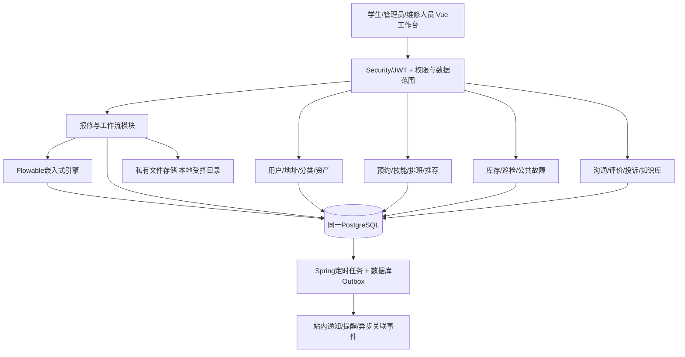

# 02 系统总体架构

## 约束与技术路线

保留Spring Boot3.5.16、Java21、PostgreSQL17、JdbcTemplate、Spring Security/JWT、Flowable7.2.0，前端Vue3+Element Plus。V2设计不是版本升级授权。引擎与业务继续共用DataSource和Spring事务管理器。

模块化单体，不拆成微服务，不先引入Redis、MQ、ES、Kubernetes或外部地图服务。文件初期放Web静态目录之外的受控磁盘；将来确需多实例共享时再抽象对象存储适配器。

## 包与调用规则

建议com.dormrepair下逐步按auth、order、workflow、catalog、asset、schedule、inventory、inspection、collaboration、notification模块组织，每模块保留Controller→Service→Repository。公共能力只放identity、pagination、error、audit、file-access等小模块，不把业务塞进万能BaseService。

保持V1包/接口可运行，按模块迁移，不做一次性全项目重命名。跨模块由应用Service协调；Repository不调用别的模块Service。Flowable适配接口按流程代际分发，不让库存/前端直接完成任务。

## 权威与一致性

- 业务表是工单领域数据权威，引擎是执行节点权威；不是两套各自可写状态机。只有受控命令同时更新并校验两者。
- 身份取JWT subject，启停/auth_version/权限从数据库检查；JWT中的角色仅兼容或UI提示。
- 工单写命令先锁工单，再按ID顺序锁维修人员/库存记录；禁止某条路径反向锁回工单。
- 出库先锁材料申请/工单，再按item_id排序锁余额；同一事务写余额、流水、消耗和Outbox。
- 请假审批锁维修人员并检查已确认预约，不在持有人员锁时反向修改多个工单；先返回冲突，改期逐单另行处理。
- 数据库隔离通常READ COMMITTED+行锁，计数/分页或详情组合读可用REPEATABLE READ；事务不能包含文件上传字节流、HTTP/邮件发送。

## 文件与Outbox

先上传到临时私有对象，校验类型/大小/魔数并重编码图片去EXIF，确认工单时事务关联对象。事务失败留下未绑定对象，由有界清理任务在保留期后回收，不删除已绑定证据。

提交业务命令时同事务写Outbox；提交后定时worker用for update skip locked取事件，幂等写站内通知/唤醒关联流程。失败重试有次数/退避和管理员可见状态。站内通知第一版轮询即可，不引入WebSocket或短信供应商作为先决条件。

## 安全与可观测

每个命令校验权限+工单范围+节点+版本，读不可见返回404。日志记录requestId、actorId、对象ID、命令、结果、耗时，不记录Token、密码、完整请求头、照片或联系人原文。文件下载同样鉴权，不能靠不可猜URL代替ACL。

动态权限落地先种子映射原三角色。保留最后一个可管理账号，角色变更与账户禁用撤销会话版本；不把Flowable IDM作为第二套用户库。生产数据库角色和密钥策略需要单独部署审批，本轮不修改。

## 与V1的兼容

旧/api仍由V1适配器服务；V2使用/api/v2。V1原实例使用原BPMN及八状态，V2详细阶段见05。前端V2工作台能只读兼容旧单；旧接口不允许误操作V2实例。共享认证，不共享可随意跨代写入的状态转换代码。
