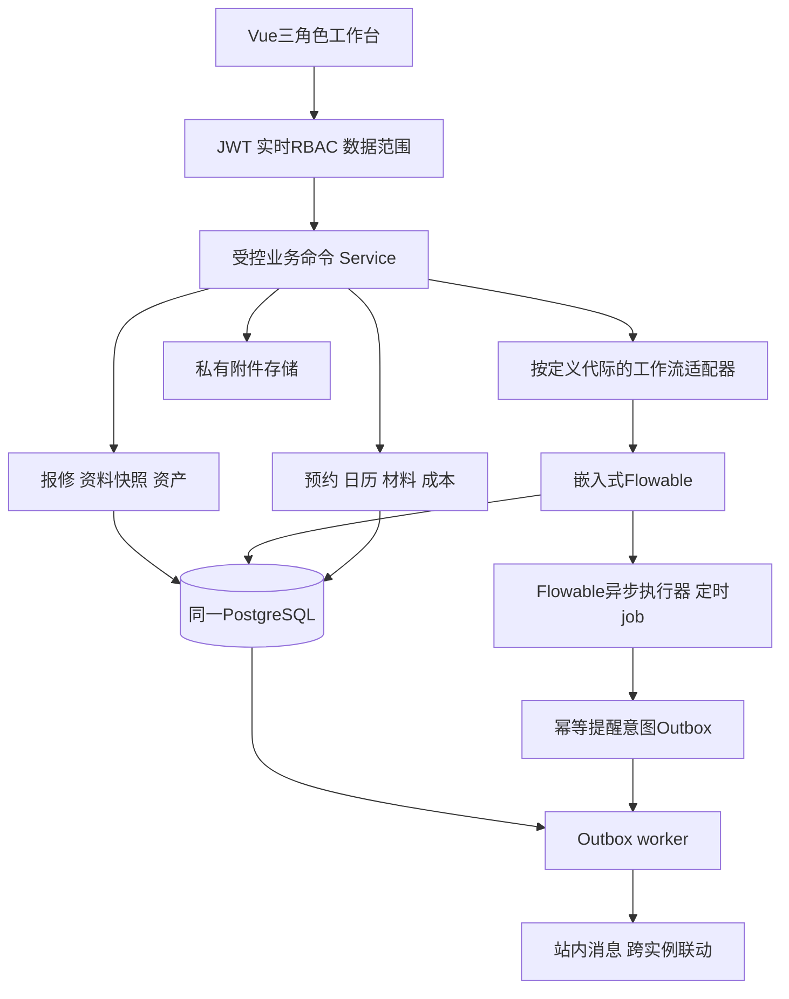

# 02 系统总体架构（R2）

## 1. 技术与模块边界

保留Boot3.5.16/Java21/PostgreSQL17.6/JdbcTemplate/Security JWT/Flowable7.2.0、Vue3/Element Plus。模块化单体、同一DataSource及Spring事务管理器；V2流程版本不是引擎升级授权。Controller→Service→Repository逐模块组织，保留V1适配器。

不引入Redis/MQ/微服务。文件暂存、重编码校验后业务事务绑定；失败只回收超过保留期的未绑定文件，不删除历史证据。

## 2. 单工单多活动任务架构

dormRepairV2包含reviewScope、workCycle、preparationScope、appointmentNegotiation、repairExceptionHandling等嵌入式作用域。preparationScope用parallelGateway同时启动预约和材料准备，join只接收两条主支路各一个token。materialRequestV2是独立流程定义，由callActivity绑定具体版本；有自己的实例ID/业务键并记录与工单、轮次、准备代次的关系。无需材料走显式直通分支。

一个工单可同时有维修者预约任务、学生改期同意任务（视模型阶段）、仓库材料任务与提醒token。查询必须聚合主实例及授权可见的关联流程，不使用singleResult推断工单只有一任务。查询当前activities还包括等待join的execution和计时器，tasks数组只包含用户任务。禁止以tasks为空判已结束。

业务stage是多活动集合的稳定聚合，另返回branchStates[]与activities[]；allowedActions为当前人的任务/业务命令并集，带taskId与branchEpoch，不能仅由粗status计算。并行分支可能只有其中一个可见，不以返回数组长度暴露其他分支的敏感细节。

## 3. 事务、锁序与版本

正常命令先锁工单→相关材料申请（按ID）→维修者用户行（按ID）→库存余额（按item_id），检查orderVersion/任务ID/branchEpoch/权限再修改业务、引擎、记录、资源和Outbox。并行用户同时完成不同分支时可按工单锁串行成功；陈旧版本返回409要求重读，不丢失另一分支成果。

callActivity正常完成在同一命令中可能同步推进父流程，必须沿用该事务。仓库完成材料任务也先锁关联工单，不允许材料路径逆序从库存再锁工单。转派中断workCycle后取消未完成的两个分支及子调用；释放未发库存预留和未来预约；已发材料不能回滚历史流水，进入核对/交接任务后再允许新派单。细节见05。

Flowable定时job可能先持有引擎锁；若delegate再锁order，会与业务命令order→engine形成锁序反转。因此**提醒delegate只幂等写Outbox意图，不锁工单、不完成任务、不改共享路由变量**；提交后worker在新事务order→引擎只读复核该轮任务仍存在/到期，再发通知。失败重试不产生重复消息。其他异步delegate也不得暗中执行相反锁序；若不可避免需另行设计并用锁超时/回滚重试验证。

读取多任务、分页计数及业务版本快照时采用可重复读短事务或一致性版本复核；业务正常写READ COMMITTED+行锁。不要把上传字节流、外网通知或人工等待放事务里。

## 4. 引擎定时机制和安全启用

验收任务绑定非中断边界timer，到acceptance_due_at（该轮提交结果+7自然日）产生提醒意图，主验收不结束、不自动通过。每次返工的新验收轮次有独立deadline和eventKey。重复催办间隔需配置批准，不先写无限循环提醒。

此设计要求未来**隔离V2测试profile**启用Flowable async executor并测试持久job、重启、双实例与重试；不得因设计自动修改现在默认关闭的正式/联调开关。候选模型均isExecutable=false，不放backend流程自动扫描目录。巡检timer start部署即可能调度，后续必须显式发布/停用流程和计划，不能与Spring同规则重复触发。

## 5. 安全、审计与兼容

JWT subject提供操作者；DB检查enabled/auth_version/动态权限，旧角色仅兼容。原/api不误操作V2工单；新/api/v2身份契约固定/api/v2/auth/me。最后管理者用system_guard串行保护授权更改，相关用户auth_version原子递增。

只读BPMN返回实际processDefinitionId XML/DI与活动实例，绝不暴露完成任务/任意变量写入口。LEGACY无实例、不补造；旧单保留原dormRepair及适配器。日志只存requestId、命令、ID、结果和耗时，禁止电话/图片/Token/密码。

模块依赖与交付顺序以10为准：V2.1提前做最小技能/班次/期望时间/预约和resourcePreparation接口；完整库存V2.2交付，但V2.1必须提前最小真实材料审批/预留/实发/退交账并测试有配件并行，不能假READY。
