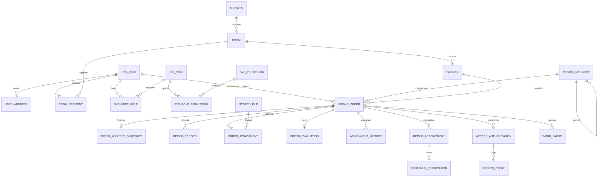
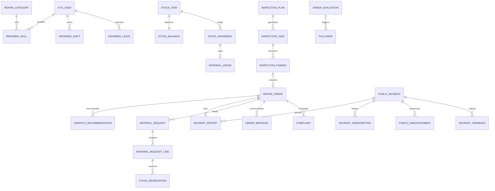

# 03 数据库ER设计

逻辑ER，不是可直接执行的迁移。字段、索引和约束以04为准；全部历史ID保留，不对Flowable运行时表建业务外键。

## 建模说明

1. student_id在V1始终非空；V2巡检或管理报修允许无学生，增加creator_id、source、acceptor_id，不创建假学生。迁移只放宽V2行，旧行维持原语义。
2. 每个工单最多一个流程实例；公共重复单不得直接共享同一个process_instance_id绕过唯一约束。保留原单与各自授权/验收。
3. 地址快照一对一，不依赖地址簿当前值；楼栋名称、房间号、联系人原文以提交时为准。V1仅有location的行标为LEGACY_TEXT，不补造联系人。
4. 预约提议以追加行和supersedes_id保留历史；确认只建立一个当前有效预订，释放旧预订与新建预订原子完成。
5. 公共投影与私密工单分离；incident_report只是关联，不意味着参与者可读其他人的工单。
6. 设施维护史优先从repair_order/record/inspection关联查询，不重复建另一套可独立篡改的“维修历史”。
7. 通知、Outbox、审计和知识库为支撑实体；不为每种消息单独建表。ER中未展开的字段及辅助表见04。
