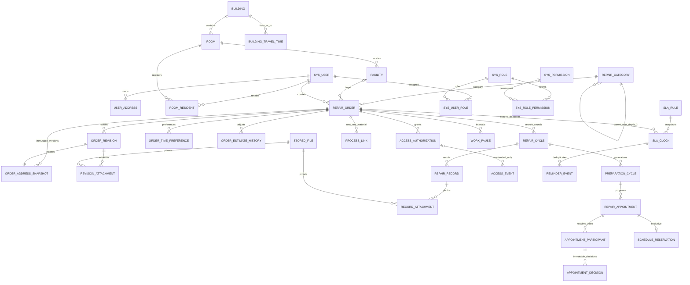
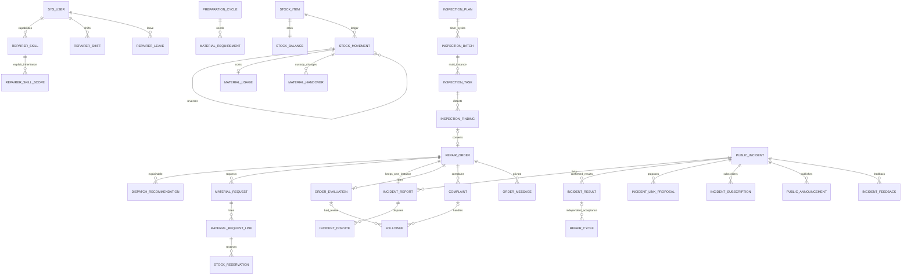

# 03 数据库ER设计（R2）

逻辑设计而非DDL。以下图与04字段/08契约对应；旧三张业务表保留，所有新增结构分阶段授权迁移。业务不对Flowable运行时表建外键；用自己的process_link记录实际定义和关联作用域。

## 关系与一致性说明

1. 用户地址、工单快照、设施的building_id/room_id使用组合唯一键+组合FK保证“房间属于楼栋”；私人设施有room，公共设施有public_zone；工单设施与快照位置必须匹配，不能同时提交矛盾位置。
2. order_revision与revision_attachment不可变；地址快照沿用提交位置，退补如允许改地址必须产生新的工单资料版本及版本化位置快照，原提交快照保留。当前地址由active_revision_id引用，不覆盖旧值。04定义快照键(order_id,revision_no)，图中版本与快照一对一、工单与快照一对多。
3. time_preference版本与正式预约不同；appointment绑定本次提议、期望版本、人员及准备代次，学生决策不能复用到改过的提议。
4. repair_cycle.round_no=0首次、1..n返工；preparation_cycle.epoch为该轮重约/重派准备代次；维修结果关联cycle。转派不直接当新返工轮次。
5. process_link记录ROOT/MATERIAL/COMPLAINT/FOLLOWUP等真实实例；订单root pi唯一，材料等用独立businessKey，不把多个业务工单共用一个root pi。
6. 普通工单资料/消息私密；public_incident是脱敏投影。incident_report仍保留自己实例及验收、消息关联和争议关系。
7. 库存退料引用原出库流水，累计退量不超实发；冲正不能删除原账。inspection_batch唯一计划周期，MI任务每个目标有独立业务键。
8. 支撑表outbox_event、notification、audit_event、knowledge_article、system_guard、api_request_dedup等字段见04；不为每个事件重复建通知系统。

## C阶段获批局部补充

2026-11-27：见[C局部补充](C-LOCAL-ADDENDUM.md)，实际结构与可编辑ER见[实际结构](../v2-development/V2.0-C-SCHEMA.md)，接口见根目录V2.0-C-API.md。旧R2标签不变，新空间与项目实体以补充记录为准；验收增加层级/循环、复合外键、权限迁移、二维码真实解码和并发/回滚。
