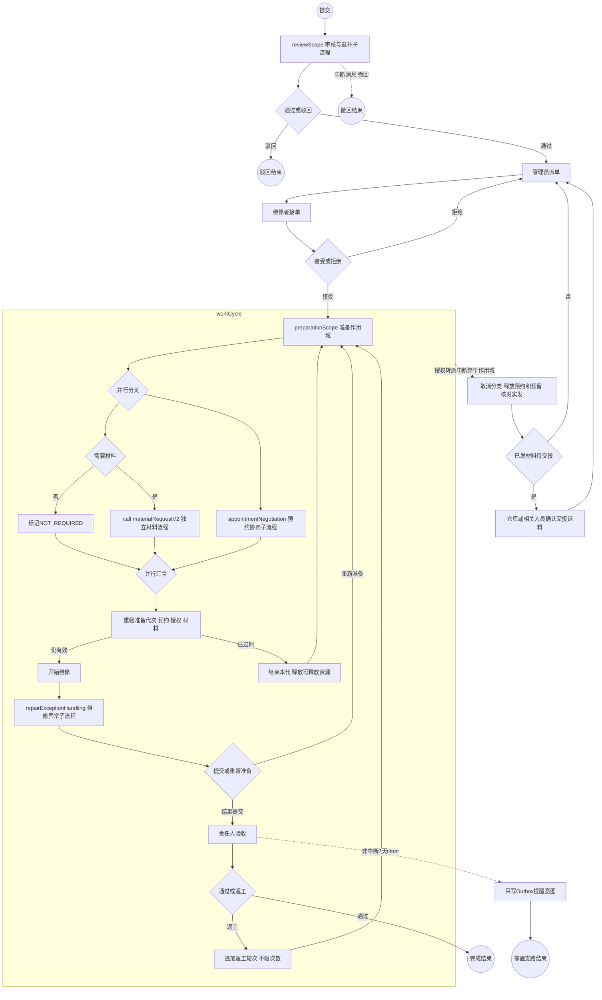

# 05 工作流设计（R2）

## 1. 定义代际与模型清单

原dormRepair及历史实例保留。新root key=dormRepairV2；材料materialRequestV2、巡检inspectionPlanV2、投诉complaintCaseV2、回访serviceFollowupV2为独立定义，有各自实例/业务键及process_link。禁止用latest解释历史；调用材料流程必须固定批准的定义版本/部署组合，升级只影响新建实例。

models/下XML均isExecutable=false，具备DI，仅评审，不在backend自动部署路径。本轮未开启async executor、未创建job。Flowable7.2.0/schema7.2.0.2保持。

## 2. 核心结构：真实并行与子流程

Mermaid表示业务结构，精确BPMN节点与scope在XML及本节表中。并行源于“学生/维修者协调时间”与“仓库准备配件”可以独立推进，不能人为加审批。无需配件由明确NONE声明直通资源支路；UNKNOWN不是NONE。V2.1提前最小真实材料流程及必要账务，同时验收有配件与无配件；完整库存能力在V2.2交付，禁止mock READY。

appointmentNegotiation内部：维修者提出时段→判断是否超原WINDOW→如超出则学生同意/拒绝/反提议→维修者确认→原子预约预订→子流程结束。拒绝重回新提议，不保留旧同意。ANY不需要窗口外同意，但必须通知且有人到场或合法有效授权。管理员可协助但不能替代这两类确认。

repairExceptionHandling内部：维修及结果任务→FINISH或PAUSE→暂停原因及资源/SLA分类→维修者协调恢复→原预约仍有效且无新增材料时恢复原维修任务，否则以REPLAN结果退出子流程、释放失效预订后新准备代次。缺件可新增材料需求；不能无限在旧join重复注入token。

## 3. 并行汇合、不变量与错误路径

|机制|精确定义|
|---|---|
|分叉/汇合|同一preparation_id/epoch恰两支：APPOINTMENT与RESOURCE；资源内部有exclusive merge后才入parallel join，每支最多一token|
|分支完成|预约分支成功必须有该代正式确认预约；资源成功为NOT_REQUIRED或真实净发料满足需求。业务状态缓存不能替代token|
|汇合重验|两token到齐后检查同一epoch、人员、工时、有效预约未过时、材料需求版本、授权/到场条件；失效则scope正常结束并新epoch重入，不能回跳某一已汇合分支|
|材料拒绝/取消|子调用返回BLOCKED等结果，在资源分支抛命名BPMN业务error；preparationScope的中断error边界取消另一预约分支及子调用，转资源协调任务，再选择新代准备。不是缺token永久等待|
|技术异常|不转业务error掩盖技术失败，抛异常使本次业务/引擎/记录回滚；异步job有可观测失败重试|
|转派|只在workCycle允许的准备/待开始/维修暂停/返工准备活动集合触发；维修者正实际施工时先受控暂停。中断整个scope，所有未完成分支/调用取消，再清理资源，保留历史任务与流水|
|撤回|学生只在reviewScope审核/补充阶段；中断整个reviewScope。审核通过后不允许以“撤回”穿透并行阶段；必要后续取消是未获授权的新业务规则|
|暂停|准备阶段资源/预约受阻为branch BLOCKED，不伪造repairWork暂停；实际维修PAUSE在异常子流程中处理。修改材料/时段须新epoch，原epoch不能迟到推进|
|材料清理|未发预留可原子释放；已发材料生成SETTLEMENT_PENDING，实物退料/转交后完成。取消任务不等于自动退库存或抹成本|
|汇合死锁防护|中断路径不回原join；没有材料的支路也产生一次token；timer支路独立end不入join；技术失败重试不产生多token；join过时重入整个准备scope|

材料子调用被中断时，未完成引擎任务取消，但已提交的审批、出入库事实不倒退。清理命令在同DataSource事务中同步处理尚未发的预留；已发账实需独立后续人工核对。并发领料/转派都先锁order，先提交者确定事实，另一方重读或409，不能从库存反向锁order造成死锁。

## 4. 非中断验收催办（必做）

acceptance用户任务绑定cancelActivity=false的timer boundary，timeDate来自该轮acceptance_due_at（结果提交+7自然日）。到期不取消验收；产生独立提醒token→queueReminder serviceTask→自己的普通endEvent，**不进入主join、不走terminate end**。验收仍需本人明确决定；超时不自动通过/派单。

提醒delegate只插幂等Outbox意图，不锁order、不改共享流程变量。worker在提交后新事务复核该轮验收仍活动/未处理才写通知；eventKey=实例+task+cycle+ruleVersion+deadline。和学生验收竞争时，已结束任务的意图标SKIPPED，不重复催办。重启/双executor/重试均需隔离验证。首次提醒7天已定，重复频率未定，候选XML仅一次定时边界。

验收7天是提醒阈值，不是到期关闭，超过7天仍可本人验收/返工。评价期限独立为最终完成后15天；不得把两种期限混用。未确认暂停规则默认SLA持续计时并保留原始区间，验收时钟不会被已结束的维修暂停冲减。

依据：[Flowable官方BPMN构件文档](https://www.flowable.com/open-source/docs/bpmn/ch07b-BPMN-Constructs/)说明非中断边界保留原活动且timer需要异步执行器。本设计选用该机制；仍需在锁定7.2.0依赖下实测，网页不是候选XML部署已通过的证据。

## 5. 多任务DTO、状态与权限

|业务粗status|聚合workflow_stage|活动集合/细分|
|---|---|---|
|PENDING|REVIEW / SUPPLEMENT|reviewScope内审核或补充|
|APPROVED|DISPATCH|管理员派单|
|ASSIGNED|WORKER_ACCEPT / PREPARING / RESOURCE_COORDINATION / READY_TO_START|接单；并行准备；准备异常资源协调；已汇合待开始|
|REWORK|REWORK_PREPARING / RESOURCE_COORDINATION / REWORK_READY|round_no>0的新准备/待开始，原维修者优先；不因预约子任务误变成首次ASSIGNED|
|IN_PROGRESS|REPAIRING / PAUSED|实际维修或暂停|
|保持中断前ASSIGNED/REWORK/IN_PROGRESS|TRANSFER_RECONCILIATION|转派核对期间orderHold限制新动作，核对后回APPROVED/DISPATCH，不强制改成IN_PROGRESS|
|WAITING_ACCEPTANCE|ACCEPTANCE|该轮验收及可能并存的提醒执行token|
|COMPLETED / REJECTED / CANCELLED|对应终态|root无活动execution；相关独立投诉/回访可能仍在，不能冒充主单未结束|

PREPARING下同时返回branchStates=[{branch:APPOINTMENT,state:...},{branch:RESOURCE,state:...}]。若一支已完且在join等待，tasks可以只余另一支，stage仍PREPARING。workCycle结束与主root结束分别判断；end不由数组为空推断。派单/暂停/材料hold是派生操作约束，不新增大量业务粗状态。

tasks[]每条含taskId、processInstanceId、processDefinitionId、scope、branch、cycleId、preparationEpoch、definitionKey、assignee/candidate摘要、dueAt、allowedActions。根allowedActions是用户可执行命令的去重集合；taskActions[]携带对应taskId/command/version。对无权限的任务返回脱敏分支状态而非姓名/库存成本等细节。仓库用户只见自己的材料任务，工单详情权限仍独立。

所有命令含orderVersion及目标taskId（适用时）、cycleId/epoch。转派/撤回等scope命令没有任意taskId完成能力，Service确定允许作用域。并行完成命令order锁串行，陈旧命令409；单动作不误完成其他分支。

## 6. 独立材料、巡检、投诉与回访流程

### materialRequestV2（V2.2；V2.1固定接口契约）

申请→库存授权审批→拒绝结束或按item锁预留→发料确认（支持部分发料，未齐回本节点）→净数量满足需求→READY结束；取消消息中断未结束的申请scope→释放未发预留/登记已发核对→取消结束。已结束发料如需退料使用独立业务命令/核对记录，不复活完成实例。业务键material-request:<id>；callActivity运行在当前准备epoch，只有成功READY回主join。无需材料不启动该实例。

### inspectionPlanV2（V2.3扩展）

顶层timer start每日候选调度→快照到期计划和目标批次→多实例inspectionUnit子流程（每目标任务→记录正常或异常→Outbox异常转单意图）→全部实例结束后汇总。计划周期唯一，空目标集合直通，分页分批/限制并发，不能一次加载全校设施。MI不使用提前完成condition，以免丢巡检；同一维修者时段仍受日历限制。异常转单由Outbox consumer在独立事务建工单+Flowable+finding关联，失败重试不留半单。顶层timer部署即可能调度，新版本timer替代机制需演练；本轮isExecutable=false。

### complaintCaseV2 / serviceFollowupV2（V2.4）

投诉提交→授权人员受理调查→给出处置→调用serviceFollowupV2回访→归档。回访：分配→联系记录→解决/需再次联系循环→完成；差评也可单独启动此定义。来源必须真实evaluation/complaint FK；被投诉维修者不能看到私密投诉内容。回访结束不自动替学生验收原单；需修理则另建有追踪关系处理单。未设自动关闭或隐性联系次数上限。

## 7. 公共故障独立实例和争议

主实际维修工单由管理员指定acceptor并确认结果。关联原单各自root，主动确认关联后在duplicateLinkedWait等待主单结果；Outbox以incidentId+原单ID+linkEpoch+主结果版本关联消息，消费者锁原单后核验仍关联/未终态再推进各自验收。不能把master pi写进多个order。

原单在审核前可正常撤回；审核通过后只能申请取消关联，管理员确认后释放旧等待订阅并回独立派单/处理，不直接取消已开始的主修。主单结果已送达后，原单仍本人验收；不同意产生incident_dispute，管理员核查并创建/关联新的后续处理工单，原验收不同意事实保留，不强制标COMPLETED、不重启终态主单。误关联解绑、新关联都递增linkEpoch，旧消息无效。主单已处置原单再请求“撤回”不删除维修成本和历史。

核心候选XML已包含publicLinkedScope扩展：review通过后按已确认公共关联选择，独立原单实例进入duplicateLinkedWait；主结果消息到达后原单验收，争议经管理员核查/后续工单结果消息再验收，解绑中断该scope回独立派单。仅V2.3启用此路径，争议时限仍待确认，不影响V2.1私密主路径验收。

## 8. 必须验证的模型行为

两支完成的两种顺序、无需材料、材料拒绝中断预约、学生拒改期、并行中转派、发料与转派竞争、准备到齐时预约已过、暂停新增配件、连续返工、timer与验收竞争、async job重启、旧epoch迟到消息、末token判断、任一路异常回滚。XML结构/DI检查不等于这些运行测试。

## 9. 收口检查与公共扩展精确性

主单终态必须在同一事务核对root已结束后落库；若正与非中断提醒job竞争，出现短暂未收口execution或乐观锁冲突，则本次命令整体回滚并返回409 FLOW_CONCURRENT_PROGRESS要求刷新重试，不持有工单锁等待后台job。提醒delegate极短且不锁工单，避免相互等待；不能提交COMPLETED同时长期留下主流程活动token。

publicLinkedScope含自己的publicAcceptance、7天非中断timer和提醒独立end；公共结果采用incident_result版本，由管理员确认。原单需通过incident_link_proposal记录本人同意关联；public cycle引用公共结果而不是伪造本单维修记录。争议后新的结果开启新验收轮次；关联epoch与结果版本共同防止旧消息误触发。每个参与原单只完成自己的验收任务，不能从管理员确认主结果推断全体已验收。

巡检MI的inspectionTarget、hasFinding和结果仅保存在各实例execution local及inspection_task业务行，不并发写root同名变量。材料call以实际定义ID绑定，并用useLocalScopeForOutParameters=true把resourceOutcome落在当前资源支路，结果在该支路网关消费，汇合后重验以业务准备行权威值为准。

### 公共关联激活节点与状态补充

候选第一版只允许在reviewScope已取得本人同意（审核通过后modeRoute分流），或尚未分配维修者的DISPATCH阶段通过linkPublicOrder中断dispatch任务并激活关联。XML包含后者消息边界与activatePublicLink校验节点；接单/并行准备/实际维修中的旧单不直接合并，返回409 LINK_STAGE_CONFLICT，避免取消真实作业和材料账。若要扩展更多节点须另评资源清理路径，不用无条件跳转。

PUBLIC_LINKED_WAIT粗status=APPROVED；收到主结果后PUBLIC_ACCEPTANCE=WAITING_ACCEPTANCE；拒绝后的PUBLIC_DISPUTE/PUBLIC_FOLLOWUP_WAIT=REWORK；本人通过才COMPLETED。原单public cycle引用结果版本与linkEpoch，独立7天deadline。主结果在关联前已存在时，激活关联的同事务写待递送当前结果Outbox，提交后等待订阅已建立再幂等投递，不能错过唯一一次消息。

解绑仅允许PUBLIC_LINKED_WAIT且结果尚未进入本单验收；本人申请、管理员确认，废弃当前linkEpoch并回DISPATCH。结果已进入验收后用争议/后续处理路径，不通过解绑抹除已发生事实。主维修不会因某原单撤回/解绑而自动取消。上述激活/解绑可用节点作为本轮候选限制，请最终评审确认，不在实现前默认扩大。
