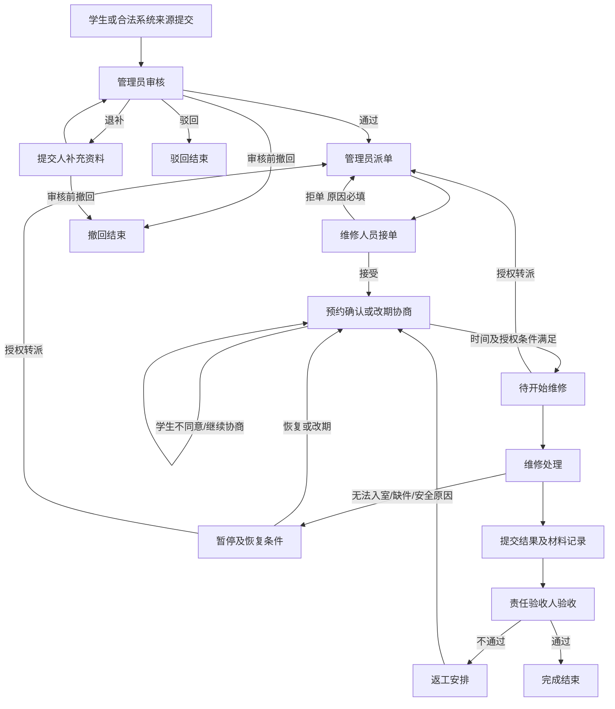

# 05 工作流设计

## V1真实基线与版本策略

现有process key=dormRepair，当前隔离库部署版本1（将来以实际definitionId为准）；节点adminReview→adminAssign→repairStart→repairFinish→studentAcceptance，验收失败经reworkStart回到repairFinish；REJECTED/COMPLETED结束。当前Service显式使用此key，业务状态和任务在同一事务推进。

**V2使用新key dormRepairV2**，不覆盖或删除原定义。记录process_definition_id、generation与映射版本；新单按开关选择V2，运行中实例继续绑定原定义。引擎7.2.0和schema7.2.0.2不随业务BPMN版本一起升级。

LEGACY没有实例；V1终态不补建实例；V1运行单由V1适配器收尾，默认不执行changeActivityState或实例迁移。确需迁移时先导出每种状态/任务/变量映射，逐单演练并另行批准，不能把改状态字段当迁移。

## V2主流程

图为业务设计，未来BPMN需带可编辑DI坐标与自动化路径测试；本轮不写可执行V2 BPMN。

## 业务状态与节点

保留status八状态作为兼容粗状态，V2新增CANCELLED（撤回不等于驳回）；新增workflow_stage表达细阶段，不能把暂停当作已完成。

| status | V2阶段/节点 | 主体 |
|---|---|---|
| PENDING | review/supplement | 审核权限人员/提交人 |
| APPROVED | dispatch | 派单权限人员 |
| ASSIGNED | workerAccept/appointment/scheduledStart | 指定维修人员及预约参与者 |
| IN_PROGRESS | repairWork/paused | 指定维修人员，受暂停/入室条件限制 |
| WAITING_ACCEPTANCE | acceptance | student或巡检指定管理员acceptor_id |
| REWORK | reworkSchedule | 原维修人员优先但必须重新校验可用性 |
| COMPLETED/REJECTED/CANCELLED | 对应结束事件 | 无活动任务 |

V1状态与V2粗状态含义不同处必须连同generation/stage展示，不能仅凭status画按钮。allowedActions由版本适配器+权限+归属+任务+预约/授权条件计算。

## 命令与事务

每条命令锁工单→查当前任务/定义→检查权限、行版本和前置条件→条件更新业务→完成/转移任务→核对新节点/状态→写审计/Outbox→提交。预约确认同时锁人员日历；材料领用单独受库存事务约束。任何引擎失败整单回滚。

审核与撤回竞争：先获得工单锁并提交者胜，另一方409。退补不重建工单ID；资料更新留版本。拒单保留assignment_history，不允许任意维修人员拒其他人的任务。

改期使用新的预约提议，原已确认预约在新提议确认前不能被静默替换；正式切换时原子释放旧预订。转派需检查旧维修/材料/预约状态，释放或重新绑定资源并撤销原任务操作权，禁止直接改repairer_id。

无法入室不得被视为学生授权；缺件暂停可发领料申请，但库存事件不能直接绕过恢复命令。暂停是否停止SLA计时是待确认政策，原始时间区间始终保留。

超时先产生幂等提醒，不自动验收或转派；使用BPMN边界定时事件或统一扫描，避免同一规则双重触发。结束后的差评/投诉生成独立回访任务，不复活原结束实例。

## 公共故障合并候选

第一期先做关联、查重建议和公共公告，不自动改原单状态。真正合并建议后续采用主单维修+各关联单duplicateLinkedWait消息等待节点：主单提交结果后，通过Outbox幂等通知各子实例进入各自验收；每个实例保持自己的businessKey和权限。

子单返工不能重启已结束主单，生成/关联一次明确的后续处理任务；材料只在实际处理工单记账。主单验收主体、多人不同意时的处理及关联后撤回规则需确认后才能启用此分支。禁止直接把多张旧V1单指向一个流程实例。

## 真实BPMN动态可视化

后端先校验订单可见性，再读取实例实际processDefinitionId对应BPMN XML/DI、运行活动ID及历史活动。结束单使用HistoryService，LEGACY返回mode=LEGACY，不伪造高亮。前端使用bpmn-js等只读渲染器（依赖需实际验证），不将模型器或流程变量写权限开放给普通用户。

返回活动定义ID及活动实例ID/开始结束时间，循环返工不能仅用一个visited布尔值。历史清理前明确保留期；历史不存在返回受控“历史不可用”，不能假装已完成。

## BPMN 2.0节点落地约定（待实施）

|节点ID|BPMN类型|候选/分配与完成条件|
|---|---|---|
|submitStart|startEvent|业务创建事务启动，以repair-order:<ID>为businessKey|
|review|userTask|具有order:review权限的授权管理员；decision网关显式区分通过/驳回/退补|
|supplement|userTask|creator本人；提交后回review，原工单ID与资料修改史保留|
|dispatch|userTask|dispatch:manage；校验目标人员后设置assignee变量，不由前端任意写变量|
|workerAccept|userTask|当前repairerId；接受进入预约，拒绝经exclusiveGateway回dispatch|
|appointment|userTask|预约协调任务，候选人为授权协调者；学生/维修者确认记录在业务表，只有策略要求的确认齐全才完成任务，不把候选权限当作已获学生同意|
|scheduledStart|userTask|当前维修者；时间、预约与入室条件满足后开始|
|repairWork|userTask|当前维修者；提交结果去acceptance，暂停经显式结果网关去paused|
|paused|userTask|当前维修者协调恢复，缺件/无人在场原因保留；恢复重新检查预约条件|
|acceptance|userTask|acceptorId，学生本人或巡检责任管理员；通过结束，返工进reworkSchedule|
|reworkSchedule|userTask|原维修人员及协调方重新确认可行时间；不可用时必须授权转派，不能自动换人|
|completedEnd/rejectedEnd/cancelledEnd|endEvent|独立终态；终态无剩余用户任务或资源占用|

撤回、转派等外部业务命令使用明确消息/中断事件路径：撤回仅review/supplement可接收；转派仅指定的scheduledStart/paused可接收。实施时用BPMN中断事件子流程或对应任务边界消息事件建模，并在同一工单行锁下校验来源节点；不能用无限制changeActivityState替代合法路径。每个分支结果必须有默认错误处理，缺变量时回滚而非猜测。

提醒采用非中断边界timer或统一扫描二选一，默认建议课程版统一扫描并写唯一Outbox事件。若后续启用BPMN timer，需显式启用隔离环境async executor并验证多实例锁/重试后，再申请正式配置变更；V1默认关闭的执行器本轮不改。
