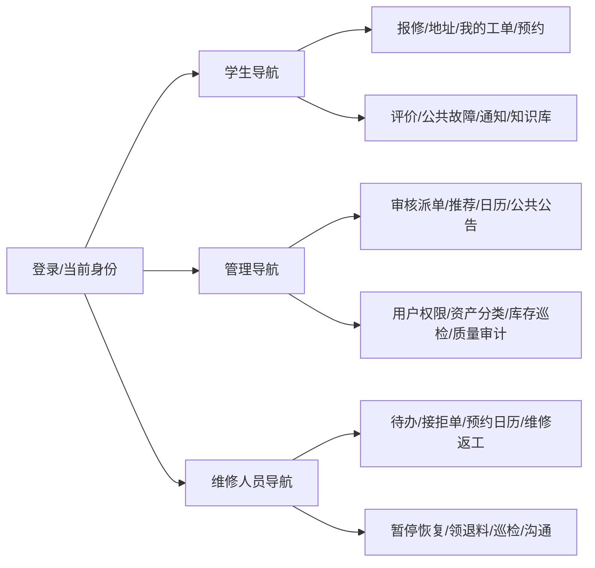

# 07 前端页面与导航规划

保留Vue3、Element Plus、Axios和现有配色/布局，不重新建设另一套前端。V1工作区作为旧单适配入口，逐步抽出可复用OrderList、OrderDetail、WorkflowView、AttachmentViewer，不做一次性框架重写。

## 页面与权限

| 工作台 | 核心页面 | 数据范围 |
|---|---|---|
| 学生 | 多级分类快捷报修、图片、地址簿、期望窗口与授权、详情/BPMN/记录、评价投诉 | 本人；公共模块仅脱敏投影 |
| 管理员 | 审核退补、手工/推荐派单、预约冲突、资产、人员排班、材料、巡检、公告、回访 | 每个菜单与命令的动态权限及范围 |
| 维修人员 | 可处理待办、接拒单、日历改期、入室记录、暂停/恢复、结果/材料、巡检 | 当前分配且在授权范围内 |
| 共用 | 个人中心、站内通知、知识库 | 自己或已发布公共内容 |

菜单隐藏只是体验，按钮必须用allowedActions，路由权限和后端仍逐次验证。动态RBAC通过/api/v2/auth/me给permissions/availableWorkspaces，不根据角色名称硬推所有菜单。多角色切换仅是工作台选择，不提升权限。

## 交互契约

V2使用明确分页对象items/page/size/total和camelCase；V1数组接口保留，不把本页数量叫全量统计。筛选/排序参数发送服务端，取消请求或版本号丢弃旧响应，单页有界并发。

提交按钮同步busy保护+关键命令幂等键；409刷新详情并保留可重新提交的非敏感草稿。401清除登录，403提示权限，404统一不可见，503可重试；不要自动重放库存扣减/派单。

地址提交前预览快照；预约明确标注“期望/提议/已确认”，改期不偷偷覆盖旧时间。无人值守授权单独确认并显示范围/有效期/撤回入口，不与普通勾选条款混为一谈。

图片通过鉴权下载Blob并及时revokeObjectURL，不能把JWT放进img URL；公共图片必须经脱敏审核。沟通内容按文本渲染，不v-html任意HTML。

BPMN只读显示真实实例定义版本、当前任务、历次活动，LEGACY显示无实例；关闭浏览器不影响流程。暂停/预约状态不能仅由粗status猜测。

## 实施顺序

先复用V1列表与详情，加分类/地址/附件/评价；再预约/人员日历与推荐；然后资产、公共同步、库存巡检。统计大屏最后，先确保基础数据口径正确。移动端用现有响应式栅格逐页测试，不先做独立App或小程序。
