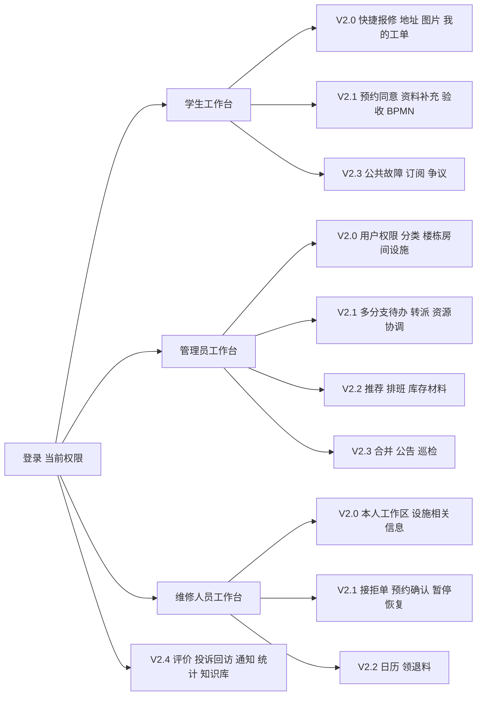

# 07 前端页面与导航规划（R2）

保留Vue3、Element Plus及V1页面视觉，不整体重写。三类独立工作台，动态RBAC决定菜单、数据范围及按钮；工作台切换不提升权限。身份契约固定GET /api/v2/auth/me，旧/api/auth/me继续兼容原客户端。

## 页面与契约

|页面|关键交互|安全/边界|
|---|---|---|
|分类报修|八根最多三级、常用入口、6张5MiB图片、WINDOW/ANY|服务端同样校验；选设施默认真实位置，矛盾地址报错|
|资料详情与退补|显示revision时间线、每版附件/地址快照；最新与历史明确区分|不可将地址簿改动同步到历史单|
|预约协商|原期望独立显示；提议/学生决定/维修者确认/正式预约不同标签|窗口外必须学生同意；ANY不能当无人值守同意|
|并行准备看板|APPOINTMENT与RESOURCE两列；各有状态、任务、当前人操作|一个完成不代表可维修；NO_PARTS直通也显示；仓库只看材料必要投影|
|维修异常子流程|无法入室/缺件/安全暂停、恢复条件、需重新准备提示|更改材料或过时时间进入新epoch；不暗中修改原预约|
|返工记录|roundNo、各轮结果/图片/验收、异常多次提醒|次数不强制封顶；记录不可覆盖|
|BPMN只读视图|实际版本、并行多活动高亮、子流程展开/下钻、timer图标、历次活动|结束用历史；LEGACY无实例；材料独立模型按授权切换，不暴露编辑/complete入口|
|材料核对/转派|已预留/已发/待退/已交接区别；转派协调提示|已发不能假装退库，hold解除前不开始新工作|
|评价投诉回访|完成15天内评分、无预约守时为空、投诉私密|超期评价提示截止；验收7天只是提醒，不能自动验收|
|公共详情|主实际结果及本人原单验收/争议入口|不展示原单联系人/房号/电话及其他人验收详情|

## 多任务交互规范

workflow响应tasks[]和activities[]，展示可见任务卡片，不能取tasks[0]作为工单唯一任务。根allowedActions用于概览，真正提交使用对应taskActions的taskId/orderVersion/cycleId/preparationEpoch。刷新后目标任务消失则取消旧弹窗并提示已更新；409保留非敏感草稿，重新读取，不自动重放。

branchStates中已完成分支等待join仍显示“等待另一分支”，不显示整个工单完成。TRANSFER_RECONCILIATION、RESOURCE_COORDINATION有明确原因/责任方，不显示假进度。未见某分支任务可能是无权限，不提示具体仓库人员私人信息。

服务端分页对象items/page/size/total，size<=100；筛选重置page；列表批量附流程摘要，展开才取有界记录/活动，避免每行重复取所有模型。BPMN模型可按实际definitionId缓存，但活动数据不静态缓存。

401清会话回登录；403权限提示；404统一不可见；409刷新；503受控重试。加载/空态/超时/重复点击保护沿用V1；文件鉴权Blob下载并revokeURL，禁止JWT img URL或v-html未清洗内容。

## 分期前置

V2.1同时具备预约最小班次/技能/估时/通行配置；V2.1必须提前真实最小材料流程并验证两支并行；完整库存管理V2.2交付。V3.0做整体界面和移动端适配，不借本轮设计新增页面代码。
