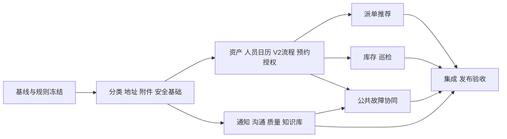

# 10 分阶段开发与验收计划

## 范围与人力

本目录完成总体设计，不代表V2已经实现。两人团队应先确认课程演示必做范围，按垂直业务链路交付；不在一个迭代同时建设全部九个模块。现有V1.1稳定标签是回退参照，开发在feature/v2-development及短期功能分支，不改写队友原始历史。

下列人日为两人合计投入，1人日按约8小时；课余每周实际投入需另行换算。全量范围约70–120人日并留20%集成缓冲，不能承诺短期全部完成。建议课程MVP选择P0/P1和P2最小预约工作流，P3按时间加入，其余以设计与可验收小模块排期，经用户确认后冻结。

## 分阶段交付

|阶段/优先级|后端负责方向|前端负责方向|难度/预计人日|可验收结果|
|---|---|---|---|---|
|P0 必做|核对V1实际结构、契约、流程版本、权限基础种子；冻结待定规则；建立隔离迁移基线|梳理三角色导航/共用组件、契约和演示脚本|中，3–5|V1回归通过，规则清单签认，无正式DB写入；每阶段有测试数据初始化与启动说明|
|P1 必做|分类树/地址快照/私有附件/评价/账号停用与最小RBAC；扩展迁移和旧Token兼容|快捷报修、地址管理、上传、评价、个人中心及管理入口|中高，15–25|新报修地址变更不影响历史；文件越权拒绝；三角色权限通过；V1与新基础能力兼容|
|P2 推荐MVP核心|设施/二维码、技能排班请假、预约与授权、dormRepairV2流程及版本适配器|日历/改期、接拒单/暂停、真实流程图，保留原视觉|高，18–28|V1在途实例照常完成；V2从提交到返工再验收；并发预约不冲突；默认无无人值守授权|
|P3 课程亮点|确定性推荐、快照解释、提交重验|候选排名/分量解释与管理员确认|中高，5–8|无技能/请假/冲突候选剔除；无解可解释；推荐不自动派单|
|P4 可拆分|库存账/申请/预留/出入库、巡检周期与异常转单|库存与领料、巡检任务界面|高，12–20|并发扣减无负库存、流水可对账；同一计划同一周期只一任务、异常只转单一次|
|P5 可拆分|Outbox/通知、沟通投诉回访、审计、知识库、基础统计|通知中心、沟通区、投诉回访、简明图表与知识库|中高，10–18|事务失败无错误通知；消息不越权；差评不重开完成流程；统计口径一致|
|P6 后置|公共投影/重复候选/软关联；确认业务规则后再真正流程联动|公共故障进展/订阅/公告，不显示私密地址联系人|高，8–15|私人信息零泄露；多工单不共享实例；主单结束与各子单独立验收/返工一致|
|发布门禁|迁移演练、回滚/前滚预案、全链路一致性|真实浏览器三角色回归、lint/build、部署说明|高，按总投入另加缓冲|双方共同验收，明确批准后才迁移正式库/发布|

基础审计和必要Outbox应随首个相关模块一起交付，P5不是允许前期敏感命令无审计。两人可以并行实现同阶段前后端，但每周至少一次真实接口联调；不要以Mock页面替代验收。

## 必测矩阵

|领域|关键验收|
|---|---|
|历史保护|正式迁移演练副本中原用户/密码哈希、工单1/2/3、维修记录逐项不变；LEGACY不生成实例|
|流程版本|同库V1在途、V1完成、LEGACY、V2在途和完成同时查询；实际definitionId与图匹配；多次返工活动可区分|
|事务|在业务写入后、Flowable完成后、记录/库存写入后分别注入异常，状态/任务/记录/资源/Outbox一并回滚|
|并发|双审核/双派单/双维修提交仅一次成功；两工单抢同人同时间只一确认；反向转派无死锁；库存末件只一领取|
|安全|无/无效/过期Token、停用、改权立即失效；跨学生/维修者访问404；管理员功能无权限403；不能伪造actorId|
|文件与隐私|超限/伪扩展/恶意类型/路径穿越拒绝；私有下载鉴权；EXIF去除；二维码不泄露住户；公共反馈与截图无联系方式|
|调度|技能、班次、请假、时区、边界相接、无坐标、无时长、过期推荐及提交竞争；无解时管理员人工处理|
|预约授权|改期未同意前保留旧预约；授权过期/撤销不能入室；无人值守默认关闭；无法入室暂停可恢复|
|库存|预留/出库/退料/冲正对账；重复幂等键同体返回原结果、异体409；取消与发料竞争一致|
|定时事件|应用重启/多实例不重复巡检；Outbox重复投递不重复通知；失败可观测和重试，不静默吞异常|
|浏览器|三角色正常/驳回/补充/拒单/改期/暂停/两次返工/验收评价，加载空态异常和重复点击；真实JWT过期退出|
|性能与可用性|所有列表上限与SQL分页；批量关联无N+1；关键SQL检查执行计划，目标延迟在约定数据量/硬件后确定|

阶段完成必须列出实际执行数、失败与未验证项，留存脱敏证据。保留V1现有66项回归；测试数量随开发扩展，不能预先宣称通过。浏览器验收与HTTP测试分别记录。隔离环境端口18080/5173，不占用8080。

## 待确认决策与启动门禁

开发前首先确认：课程MVP模块、图片上限、分类深度/技能继承、预约时长来源与最终确认人、无人值守代理授权资格、请假与已约预约冲突处理、SLA暂停与催办阈值、是否自动验收（建议暂不）、评价修改/返工窗口、公共工单验收与撤回规则、数据与附件留存期。推荐权重仅候选值，必须以样例验证后配置。

不明确的复杂规则保留候选方案，不以实现便利自行决定；阻塞模块可后置，其他已确认模块可继续。每次正式结构变更、Flowable引擎版本升级、正式密钥调整、数据修复/删除都需单独明确授权。本轮只归档V1.1和提交设计，不执行上述动作。
