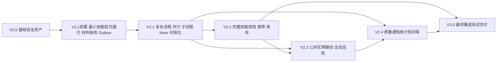

# 10 分阶段开发与验收计划（R2）

## 1. 编号与容量

需求优先级MUST/SHOULD/LATER，交付版本V2.0–V3.0；弃用歧义P编号。以下人日为两人合计、约8小时/人日的粗估，不是完成日期或实际投入承诺。完整愿景约104–168人日，另按风险留15%–25%机动约120–210人日；V3.0已含常规集成，机动用于未知风险，不重复承诺固定工期。课余每周人时先确认，再选课程MVP与版本内容。

## 2. 实际依赖和交付

|版本|工作内容与责任方向|必要提前依赖|粗估人日/难度|交付验收|
|---|---|---|---|---|
|V2.0|后端安全/RBAC/分类/地址快照/私图/资料/期望/估时/楼栋房间设施；前端对应报修和管理|原V1.1/JWT兼容、基础审计|18–28，高|BR01–04、位置一致与历史保护；原流程不回归|
|V2.1|后端并行准备、预约/异常子流程、接拒/转派/暂停、非中断7天timer、多任务契约；前端双支路与真实BPMN|最小班次技能/通行；真实最小材料审批预留实发退交账；Outbox/站内基础提醒|28–44，很高|必须有真实有配件并行和无配件路径，不以mock READY验收；中断/汇合/定时/回滚全部证明|
|V2.2|完整技能排班请假、可解释推荐、完整库存预警/成本对账/材料流程管理|V2.1最小模型延续，禁止重建另一套账|16–26，高|硬约束/人工决定、并发余额与原价退料、工时/通行快照|
|V2.3|公共协同/合并/独立验收/争议；timer start+MI巡检|V2.1事件与V2.2资源；关联epoch/批次唯一|16–26，很高|多人原单独立权利、消息幂等；巡检空集合/重启/分批/异常转单|
|V2.4|评价、投诉/独立回访流程、完整通知、统计/审计/知识库|基础通知不是此时才建设；沿用V2.1Outbox|14–24，高|15天评价/无预约守时null、隐私、闭环回访不复活原单、统计口径|
|V3.0|最终整合、界面优化、浏览器/回归/迁移演练、部署交付|前述获批模块|12–20，高|完整演示和安全回归、性能报告、批准的部署方案|

两人分工：后端负责事务/约束/模型和契约，前端负责既有视觉下的三角色流程视图/日历/模型下钻；每个版本共同用真实账号/浏览器验收。课程范围建议优先V2.0+V2.1核心亮点，其他按实际剩余容量分期，不把总体设计视为一次实施授权。

## 3. 同步验收矩阵（以下全部是未来待执行）

|ID|版本/规则|场景与预期|
|---|---|---|
|AT01|全部|原66项JWT/A/B/C/D及V1浏览器闭环回归；正式用户/1/2/3/记录摘要不变|
|AT02|V2.0 BR01|6张成功、7张拒绝、5MiB边界、伪类型/解码炸弹/私有越权、EXIF去除；历史图片不被新版本覆盖|
|AT03|V2.0 BR02/03|三级合法/四级拒绝、环拒绝；SELF不含后代、SUBTREE明确继承|
|AT04|V2.0|楼栋/房间/设施矛盾400/FK拒绝；地址更改/设施移动不改旧快照；退补修订完整|
|AT05|V2.1 BR04/05|ANY、窗口内维修者确认、窗口外学生同意/拒绝/反提议、新提议不能复用旧同意|
|AT06|V2.1|真实预约先完成/材料先完成两顺序各一次join；无材料直通；UNKNOWN材料不直通；tasks不止1时权限正确|
|AT07|V2.1|材料拒绝/取消导致准备scope中断另一支，不悬空join；协调后新epoch只一次分叉|
|AT08|V2.1|并行中转派、确认预约同时转派、领料同时转派；取消所有旧任务/子调用，未发释放，已发交接核对；旧epoch消息无效|
|AT09|V2.1 BR06|默认无无人值守权；撤销/过期/有人在场不同模式；记录意愿不能代校方许可|
|AT10|V2.1|无人在场/缺件/安全暂停；预约有效原地恢复或需新epoch；无遗留timer/任务/预留|
|AT11|V2.1 BR08|真实Flowable非中断timer到7天触发，主验收仍活动；提醒支路独立结束；与验收竞争/重启/双executor只通知一次|
|AT12|V2.1 BR09|两次及更多返工，每轮记录/deadline独立；阈值提醒不阻断返工；历史BPMN多活动/循环可见|
|AT13|V2.1事务|在业务写/引擎推进/记录/库存/Outbox处故障注入，整命令回滚；order→engine与timer→意图锁序无反转，超时重试可观测|
|AT14|V2.2 BR07|双预约抢同人/班次边界/跨日；请假与已约冲突先改期；不静默取消|
|AT15|V2.2|缺工时/通行/技能不伪造；人工调整版本，推荐陈旧409、硬约束不能被评分抵消|
|AT16|V2.2成本|末件并发只一成功，预留/实发/部分发/原价退/冲正对账、重复幂等和超退拒绝|
|AT17|V2.3 BR11|管理员确认主结果、原单同意关联与独立7天timer，各原单独立验收；一原单拒绝不重启主单；解绑/撤回/迟到消息/争议追踪|
|AT18|V2.3巡检|timer start受控启用、同周期唯一、MI独立目标/空集合/大集合分批、同人日历、异常转单幂等和回滚|
|AT19|V2.4 BR08/10|评价15天前后边界、未预约守时null；评价编辑按待确认政策；差评/投诉启动独立回访不代验收|
|AT20|V2.4|投诉知情范围/消息授权、Outbox至少一次去重、统计去公共重复/返工次数口径、知识库安全发布|
|AT21|全部安全|无/坏/过期/失权Token，跨用户404/功能403，最后管理员并发保护，仓库任务不泄露宿舍电话|
|AT22|V3.0|三角色真实浏览器路径、loading空态异常/双击，lint/build、分页上限/N+1/执行计划、记录P95但不虚构指标|

每项报告实际执行/失败/未验证，保留脱敏证据。单纯XML解析、DI几何检查和Mermaid代码校对不是AT06–18运行通过。全新profile不占8080，正式DDL/开关/密钥变更单独申请。

## 4. 仍需最终确认

校方入室规则、提醒重复频率/异常返工阈值、SLA各暂停原因是否停表、财务移动均价/尾差处理批准、公共争议响应时限、评价编辑/数据留存、巡检周期与漏跑上限、技能SUBTREE管理权限及推荐权重、实际MVP容量。已采用规则不重新询问。未确认项阻塞对应模块上线，不阻塞其他已确认设计。

## C阶段获批局部补充

2026-11-27：见[C局部补充](C-LOCAL-ADDENDUM.md)，实际结构与可编辑ER见[实际结构](../v2-development/V2.0-C-SCHEMA.md)，接口见根目录V2.0-C-API.md。旧R2标签不变，新空间与项目实体以补充记录为准；验收增加层级/循环、复合外键、权限迁移、二维码真实解码和并发/回滚。
