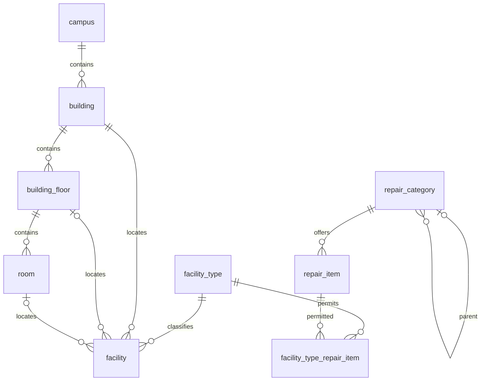

# C阶段实际实体关系与字段

## 权威位置与分类

所有新实体ID bigint，V2响应字符串；可修改实体version>=0，默认0。无物理删除接口。

|表|字段与约束|
|---|---|
|campus|id/code全局唯一/name唯一/enabled/sort_order>=0/version/created_at|
|building|id/code全局唯一/name/campus_id FK/enabled/sort_order/version/created_at；同校区名称唯一|
|building_floor|id/building_id FK/floor_no[-20,200]/name/enabled/sort_order/version；同楼栋编号和名称各唯一；(id,building_id)复合唯一|
|room|id/floor_id FK/room_no/name/kind PRIVATE或PUBLIC/enabled/sort_order/version；同楼层房号及名称各唯一；(id,floor_id)复合唯一|
|repair_category|id/parent_id自引用FK/code全局唯一/name/enabled/sort_order/version/created_at；根固定八个；DB触发器限制循环、树高及移动后的整棵子树|
|repair_item|id/code全局唯一/name/category_id FK/estimated_minutes[1,1440]/is_quick/enabled/sort_order/version/created_at；同分类项目名称唯一；不与任何分类同名|
|facility_type|id/code全局唯一/name/enabled/sort_order/version/created_at；无继承|
|facility_type_repair_item|type_id/item_id复合PK与FK，反向索引|
|facility|id/asset_no全局唯一/name/facility_type_id/building_id/floor_id可空/room_id可空/public_zone可空/status ACTIVE或MAINTENANCE或DISABLED/version/qr_token/qr_token_hash唯一/created_at|

facility.floor_id/building_id及room_id/floor_id使用复合外键。位置要么房间（public_zone为空），要么公共区域（public_zone必填，可只指定楼栋或楼层）。均on delete restrict。设施索引位置/状态/id、类型/id；分类及项目父级/排序/id索引。

旧campus文本、room.floor_no、facility.category_id在R2仅逻辑设计，未实际落表，故不创建冗余。权威校区来自building.campus_id；楼层号由room.floor_id关联；设施可选项目由facility_type_id多对多关联决定。未来地址快照属于后续阶段，不借兼容之名创建两个可修改来源。

V2新增权限module=V2_FOUNDATION，保留B已有模块。V4创建九表、八根分类和六权限，V5补齐校区名称唯一及跨分类/项目名称保护。public业务表共19，不包括独立schema中的Flyway历史。

## 补全版V6

不新增业务表；新增受控授权模板规范和脱敏迁移审计，非空库映射使用连接本地临时表，不作为业务模型。public仍19张业务表。批量查询与访问隔离不引入Redis或新框架。详见V6-CONTROLLED-MIGRATION.md。

## 补全后实际列清单（V6，结构信息）

|表|列|类型|可空|
|---|---|---|---|
|audit_event|id|bigint|NO|
|audit_event|actor_id|bigint|YES|
|audit_event|action|character varying|NO|
|audit_event|target_type|character varying|NO|
|audit_event|target_id|bigint|YES|
|audit_event|request_id|character varying|NO|
|audit_event|result|character varying|NO|
|audit_event|details|jsonb|NO|
|audit_event|created_at|timestamp with time zone|NO|
|building|id|bigint|NO|
|building|code|character varying|NO|
|building|name|character varying|NO|
|building|enabled|boolean|NO|
|building|sort_order|integer|NO|
|building|version|integer|NO|
|building|created_at|timestamp with time zone|NO|
|building|campus_id|bigint|NO|
|building_floor|id|bigint|NO|
|building_floor|building_id|bigint|NO|
|building_floor|floor_no|integer|NO|
|building_floor|name|character varying|NO|
|building_floor|enabled|boolean|NO|
|building_floor|sort_order|integer|NO|
|building_floor|version|integer|NO|
|campus|id|bigint|NO|
|campus|code|character varying|NO|
|campus|name|character varying|NO|
|campus|enabled|boolean|NO|
|campus|sort_order|integer|NO|
|campus|version|integer|NO|
|campus|created_at|timestamp with time zone|NO|
|facility|id|bigint|NO|
|facility|asset_no|character varying|NO|
|facility|name|character varying|NO|
|facility|facility_type_id|bigint|NO|
|facility|building_id|bigint|NO|
|facility|floor_id|bigint|YES|
|facility|room_id|bigint|YES|
|facility|public_zone|character varying|YES|
|facility|status|character varying|NO|
|facility|version|integer|NO|
|facility|qr_token|character varying|NO|
|facility|qr_token_hash|character varying|NO|
|facility|created_at|timestamp with time zone|NO|
|facility_type|id|bigint|NO|
|facility_type|code|character varying|NO|
|facility_type|name|character varying|NO|
|facility_type|enabled|boolean|NO|
|facility_type|sort_order|integer|NO|
|facility_type|version|integer|NO|
|facility_type|created_at|timestamp with time zone|NO|
|facility_type_repair_item|type_id|bigint|NO|
|facility_type_repair_item|item_id|bigint|NO|
|repair_category|id|bigint|NO|
|repair_category|code|character varying|NO|
|repair_category|name|character varying|NO|
|repair_category|enabled|boolean|NO|
|repair_category|sort_order|integer|NO|
|repair_category|version|integer|NO|
|repair_category|created_at|timestamp with time zone|NO|
|repair_category|parent_id|bigint|YES|
|repair_item|id|bigint|NO|
|repair_item|code|character varying|NO|
|repair_item|name|character varying|NO|
|repair_item|enabled|boolean|NO|
|repair_item|sort_order|integer|NO|
|repair_item|version|integer|NO|
|repair_item|created_at|timestamp with time zone|NO|
|repair_item|category_id|bigint|NO|
|repair_item|estimated_minutes|integer|NO|
|repair_item|is_quick|boolean|NO|
|repair_order|id|bigint|NO|
|repair_order|student_id|bigint|NO|
|repair_order|repairer_id|bigint|YES|
|repair_order|title|character varying|NO|
|repair_order|description|text|NO|
|repair_order|location|character varying|NO|
|repair_order|status|character varying|NO|
|repair_order|created_at|timestamp without time zone|NO|
|repair_order|updated_at|timestamp without time zone|NO|
|repair_order|process_instance_id|character varying|YES|
|repair_order_legacy|order_id|bigint|NO|
|repair_order_legacy|recorded_at|timestamp without time zone|NO|
|repair_record|id|bigint|NO|
|repair_record|order_id|bigint|NO|
|repair_record|repairer_id|bigint|NO|
|repair_record|description|text|NO|
|repair_record|created_at|timestamp without time zone|NO|
|room|id|bigint|NO|
|room|floor_id|bigint|NO|
|room|room_no|character varying|NO|
|room|name|character varying|NO|
|room|kind|character varying|NO|
|room|enabled|boolean|NO|
|room|sort_order|integer|NO|
|room|version|integer|NO|
|sys_permission|id|bigint|NO|
|sys_permission|code|character varying|NO|
|sys_permission|description|character varying|NO|
|sys_permission|module|character varying|NO|
|sys_permission|available|boolean|NO|
|sys_role|id|bigint|NO|
|sys_role|code|character varying|NO|
|sys_role|name|character varying|NO|
|sys_role|enabled|boolean|NO|
|sys_role|version|integer|NO|
|sys_role|created_at|timestamp with time zone|NO|
|sys_role_permission|role_id|bigint|NO|
|sys_role_permission|permission_id|bigint|NO|
|sys_user|id|bigint|NO|
|sys_user|username|character varying|NO|
|sys_user|password_hash|character varying|NO|
|sys_user|real_name|character varying|NO|
|sys_user|role|character varying|NO|
|sys_user|phone|character varying|YES|
|sys_user|created_at|timestamp without time zone|NO|
|sys_user|enabled|boolean|NO|
|sys_user|auth_version|integer|NO|
|sys_user|version|integer|NO|
|sys_user_role|user_id|bigint|NO|
|sys_user_role|role_id|bigint|NO|
|system_guard|guard_key|character varying|NO|
|system_guard|version|integer|NO|
|system_guard|initialized_user_id|bigint|YES|
